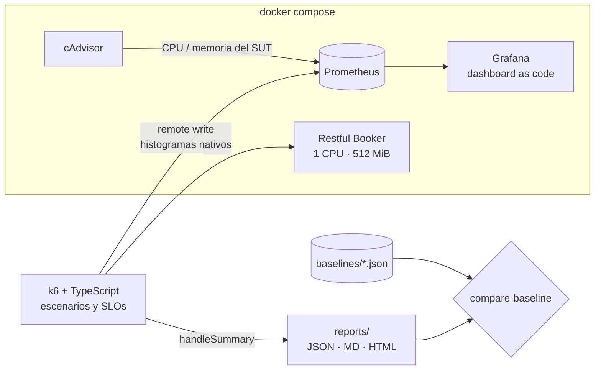
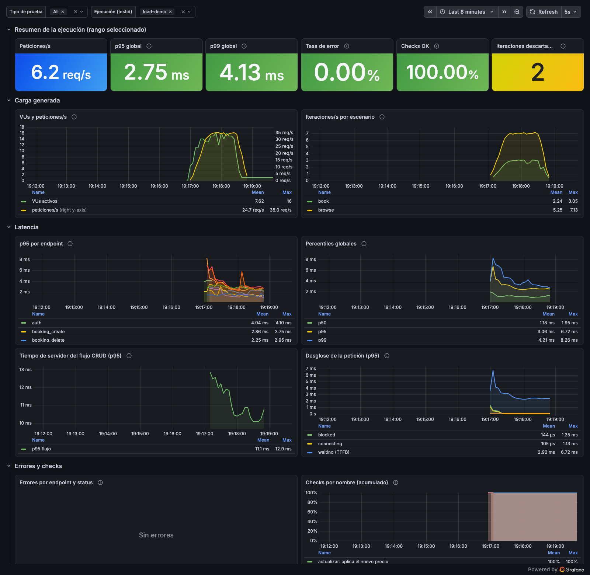

# k6-performance-lab

[](https://github.com/Dyplox/k6-performance-lab/actions/workflows/pr-smoke.yml)
[](https://github.com/Dyplox/k6-performance-lab/actions/workflows/load.yml)

Laboratorio de pruebas de rendimiento con **k6 + TypeScript** sobre la API de reservas
[Restful Booker](https://restful-booker.herokuapp.com/apidoc/index.html), que corre en Docker junto
a Prometheus y Grafana. Los SLOs están escritos como código: si una métrica se sale del objetivo, el
pipeline falla.

**Qué muestra este repositorio**

- Smoke, carga, estrés, picos y resistencia (soak) como escenarios de k6. Usan modelo abierto
  (`ramping-arrival-rate`) y se escalan con variables de entorno, sin tocar el código.
- Flujos realistas: autenticación, CRUD completo de reservas con datos parametrizados
  (`SharedArray`) y checks de status y cuerpo en cada respuesta. El tráfico se reparte 70 % lectura
  y 30 % escritura.
- **SLOs como thresholds**: p95, p99, tasa de error y checks, globales y por endpoint. Si se
  incumplen, k6 sale con código 99 y el job de CI falla.
- **Comparación con una línea base**: cada ejecución guarda un resumen JSON. Un script con pruebas
  unitarias marca las regresiones de latencia contra la versión guardada en el repo.
- Observabilidad: k6 envía las métricas a Prometheus por remote write, con histogramas nativos.
  El dashboard de Grafana está provisionado como código (JSON en el repo). cAdvisor muestra la CPU
  y la memoria del contenedor bajo prueba.
- Reportes propios con `handleSummary`: consola, Markdown para la pestaña _Summary_ de Actions,
  JSON para la línea base y HTML autocontenido publicado en GitHub Pages.
- Calidad del propio código de pruebas: TypeScript estricto, ESLint, Prettier, actions fijadas por
  SHA y Dependabot.

Todo corre en local o en runners estándar de GitHub. No usa servicios de pago ni k6 Cloud, y no
ataca la API pública de Restful Booker.

## Arquitectura



## Inicio rápido

Requisitos: Docker, y opcionalmente [k6](https://grafana.com/docs/k6/latest/set-up/install-k6/) ≥ 1.6
y Node ≥ 22.18 (solo para lint, tipos y la comparación con la línea base).

```bash
# 1. Sistema bajo prueba (misma imagen y digest que RESTFUL_BOOKERING)
docker compose up -d --wait restful-booker

# 2. Smoke (~30 s)
npm run smoke                                   # con k6 instalado
docker compose run --rm k6 run src/tests/smoke.ts   # o sin instalar nada

# 3. Con observabilidad: Grafana en http://localhost:3000 (sin login)
docker compose --profile observability up -d --wait
npm run k6:obs -- src/tests/load.ts             # o: docker compose run --rm k6 run -o experimental-prometheus-rw src/tests/load.ts

docker compose --profile observability down
```

## Tipos de prueba

| Prueba      | Archivo               | Executor               | Perfil por defecto                        | Duración | Dónde corre           |
| ----------- | --------------------- | ---------------------- | ----------------------------------------- | -------: | --------------------- |
| Smoke       | `src/tests/smoke.ts`  | `constant-vus`         | 1 VU por flujo                            |     30 s | Cada PR y push a main |
| Carga       | `src/tests/load.ts`   | `ramping-arrival-rate` | 0 → 10 it/s, sostiene, baja               |   ~2 min | Manual                |
| Estrés      | `src/tests/stress.ts` | `ramping-arrival-rate` | Escalones 10 → 20 → 30 → 40 it/s          |   ~2 min | Manual                |
| Picos       | `src/tests/spike.ts`  | `ramping-arrival-rate` | 2 → 40 it/s en 5 s, sostiene y vuelve a 2 | ~1.5 min | Manual                |
| Resistencia | `src/tests/soak.ts`   | `ramping-arrival-rate` | 5 it/s sostenidas                         |    5 min | Manual                |

Cada prueba ejecuta en paralelo dos escenarios: `browse` (listar y ver detalle, 70 % de las
iteraciones) y `book` (ciclo completo de una reserva, 30 %).

**¿Por qué modelo abierto?** Con VUs fijos (modelo cerrado), si el servidor se pone lento los VUs
esperan y la carga baja sola, así que el problema queda oculto. Con `ramping-arrival-rate`, k6 inicia
iteraciones a la tasa pedida pase lo que pase, como usuarios reales que siguen llegando. Si no le
alcanzan los VUs, lo registra en `dropped_iterations`, y ese valor tiene su propio threshold.

### Duración e intensidad configurables

Los perfiles son cortos a propósito para que CI sea rápido y gratuito. La forma de la prueba
(rampas, escalones, pico) es la misma a cualquier escala:

| Variable                                          | Defecto                 | Efecto                                                                                |
| ------------------------------------------------- | ----------------------- | ------------------------------------------------------------------------------------- |
| `TIME_SCALE`                                      | `1`                     | Multiplica la duración de todas las etapas. `TIME_SCALE=48` convierte el soak en 4 h. |
| `LOAD_SCALE`                                      | `1`                     | Multiplica la tasa de llegada y los VUs máximos. `LOAD_SCALE=3` triplica la carga.    |
| `THINK_TIME`                                      | `1`                     | Pausa media entre pasos, en segundos (±50 % aleatorio). `0` la desactiva.             |
| `BASE_URL`                                        | `http://localhost:3001` | URL del SUT.                                                                          |
| `RESTFUL_BOOKER_USUARIO` / `RESTFUL_BOOKER_CLAVE` | `admin` / `password123` | Credenciales de `/auth` (mismos nombres que RESTFUL_BOOKERING).                       |
| `TEST_ID`                                         | `<tipo>-<fecha>`        | Etiqueta `testid` en Prometheus para filtrar la ejecución en Grafana.                 |
| `REPORT_DIR`                                      | `reports`               | Carpeta de los reportes de `handleSummary`.                                           |

```bash
npm run soak -- -e TIME_SCALE=12            # soak de 1 h
npm run stress -- -e LOAD_SCALE=2           # estrés hasta 80 it/s
k6 run src/tests/load.ts -e THINK_TIME=0    # sin pausas: máxima presión por VU
```

## Flujos

**Reservar** (`src/flows/booking-crud.ts`). Cada VU se autentica una vez y reutiliza el token:

```
POST /booking → GET /booking/{id} → GET /booking?firstname&lastname → PUT → PATCH → DELETE → GET (404)
```

- Los datos salen de `data/bookings.json` mediante `SharedArray`: se cargan una vez y se comparten
  entre todos los VUs. A cada reserva se le añade un sufijo único para poder buscarla sin colisiones.
- Cada paso valida status y cuerpo. Por ejemplo, que el PATCH cambie solo el campo enviado.
- La reserva se borra al final para que la base de datos no crezca durante un soak y distorsione
  los tiempos.
- La métrica propia `crud_flow_server_time` suma el tiempo de servidor de las 7 peticiones, sin
  contar las pausas.

**Explorar** (`src/flows/browse.ts`): `GET /booking` y luego el detalle de una reserva al azar.

### Particularidades de Restful Booker que las pruebas tienen en cuenta

- Si `Accept` no es exactamente `application/json`, responde **418**. El cliente HTTP lo fija siempre.
- Un `DELETE` correcto responde **201**, no 200 ni 204.
- Con credenciales inválidas, `/auth` responde **200** con `{"reason":"Bad credentials"}`. Por eso
  se valida el cuerpo y no solo el status. `setup()` comprueba las credenciales y aborta con un
  mensaje claro si son incorrectas.
- Si el body no es válido, `POST /booking` responde **500**, no 400.
- El `GET` de una reserva recién borrada debe dar 404. Se marca como esperado con
  `http.expectedStatuses(404)` para que no cuente como error en `http_req_failed`.

## SLOs

Están definidos en [`src/lib/slo.ts`](src/lib/slo.ts) y se aplican como thresholds:

| SLO                     | Objetivo                                         | Justificación                                                                                         |
| ----------------------- | ------------------------------------------------ | ----------------------------------------------------------------------------------------------------- |
| Latencia global         | p95 < 500 ms, p99 < 1000 ms                      | Límite habitual para APIs síncronas de cara a usuario. El p99 vigila la cola, que el promedio oculta. |
| Latencia por endpoint   | p95 < 300 ms (lecturas por id), < 400 ms (resto) | Un SLO global puede cumplirse aunque un endpoint concreto esté degradado.                             |
| Tasa de error           | < 1 %                                            | Incluye status inesperados y errores de red.                                                          |
| Checks                  | > 99 %                                           | Una respuesta rápida pero incorrecta también es un fallo.                                             |
| Flujo CRUD completo     | p95 < 2 s                                        | Tiempo de servidor de las 7 peticiones que forman una reserva.                                        |
| Cobertura               | `http_reqs{name:…}` > 0                          | Si un endpoint no recibió tráfico, la prueba no es válida aunque "pase".                              |
| Iteraciones descartadas | < 10 (carga y soak)                              | Si k6 no pudo sostener la tasa, la carga real fue menor a la planeada.                                |

En **estrés y picos** se espera degradación: la latencia admite 3 veces el objetivo y la prueba se
**aborta** si los errores pasan del 5 % (`abortOnFail`). No tiene sentido seguir golpeando un
servicio caído.

Los valores corresponden al SUT con 1 CPU en un runner de GitHub. En otro entorno conviene medir
primero (la línea base sirve para eso) y luego fijar los objetivos.

## Reportes

`handleSummary` ([`src/report/summary.ts`](src/report/summary.ts)) genera los reportes sin
librerías remotas:

| Salida                        | Uso                                                                                             |
| ----------------------------- | ----------------------------------------------------------------------------------------------- |
| Consola                       | Resumen legible: totales, tabla por endpoint con su SLO, thresholds ✓/✗ y checks fallidos.      |
| `reports/<tipo>-summary.md`   | Se añade a la pestaña _Summary_ del job en GitHub Actions.                                      |
| `reports/<tipo>-summary.json` | Instantánea compacta (versión de esquema 1): es la entrada de la comparación con la línea base. |
| `reports/<tipo>-report.html`  | Reporte autocontenido. El de carga de `main` se publica en GitHub Pages.                        |

## Línea base

[`scripts/compare-baseline.ts`](scripts/compare-baseline.ts) compara `reports/<tipo>-summary.json`
con `baselines/<tipo>.json`:

- Hay **regresión de latencia** si p95/p99 (global o por endpoint) supera la línea base en más del
  **20 %** _y_ en más de **5 ms**. La segunda condición evita falsos positivos: pasar de 3 a 4 ms es
  +33 %, pero es ruido.
- Hay **regresión de errores** si la tasa sube más de **0,5 puntos porcentuales**.
- **No compara** ejecuciones hechas con otro perfil (`TIME_SCALE`, `LOAD_SCALE`, `THINK_TIME`), ni
  falla si todavía no existe línea base: en ese caso avisa y sale con 0.
- Tiene sus propias pruebas unitarias (`npm test`, con `node:test`).

**Crear o actualizar la línea base.** Debe medirse en el mismo tipo de máquina donde se va a
comparar: un portátil y un runner de GitHub dan números distintos.

1. Ejecuta _Carga_ a mano desde Actions con los valores por defecto.
2. Descarga el artefacto `load-report` y guarda `load-summary.json` como `baselines/load.json`.
   Si lo corriste en local, usa `npm run baseline:update -- --type load`.
3. Abre un PR con el archivo. En la revisión, la línea base queda registrada como una decisión
   explícita y no como un efecto secundario.

```bash
npm run baseline:compare -- --type load                    # comparar
npm run baseline:compare -- --type load --tolerance 0.1    # más estricto
```

## CI

| Workflow                                           | Disparador      | Qué hace                                                                                                       |
| -------------------------------------------------- | --------------- | -------------------------------------------------------------------------------------------------------------- |
| [`pr-smoke.yml`](.github/workflows/pr-smoke.yml)   | PR, push a main | ESLint, Prettier, `tsc` y unitarias. Después levanta el SUT y corre el smoke con thresholds (~2 min en total). |
| [`load.yml`](.github/workflows/load.yml)           | Manual          | Carga con SLOs, comparación con la línea base, artefacto y publicación del HTML en Pages.                      |
| [`on-demand.yml`](.github/workflows/on-demand.yml) | Manual          | Estrés, picos, soak o carga con `time_scale` / `load_scale` elegidos al lanzarlo (máx. 6 h).                   |

Para publicar en Pages, actívalo una vez en _Settings → Pages → Source: GitHub Actions_. Para que el
smoke bloquee los merges, márcalo como check requerido en la protección de la rama `main`.

CI usa k6 2.4.0, la misma versión que la imagen `grafana/k6` de `docker-compose.yml`.

## Observabilidad

```bash
docker compose --profile observability up -d --wait                       # Prometheus + Grafana
docker compose --profile observability --profile cadvisor up -d --wait    # + CPU/memoria (host Linux)
```

El dashboard **k6 · Restful Booker** ([JSON](infra/grafana/dashboards/k6-restful-booker.json)) se
carga solo al arrancar Grafana y se filtra por tipo de prueba y `testid`. Incluye:

- Indicadores de la ejecución con colores según los SLOs: peticiones/s, p95, p99, errores, checks
  y descartadas.
- VUs frente a peticiones/s, e iteraciones por escenario.
- p95 por endpoint y percentiles globales, con la línea del SLO dibujada.
- Desglose de cada petición (blocked, connecting, waiting/TTFB, receiving) para saber si el
  cuello de botella está en el servidor o en la red.
- Errores por endpoint y status, y el estado de cada check.
- CPU y memoria del contenedor, con sus límites (requiere cAdvisor).

Decisiones:

- **Prometheus remote write en lugar de InfluxDB.** La salida `influxdb` de k6 solo soporta
  InfluxDB v1; para la v2 hay que compilar k6 con una extensión. Remote write viene incluido y
  comparte backend con cAdvisor.
- **Histogramas nativos** (`K6_PROMETHEUS_RW_TREND_AS_NATIVE_HISTOGRAM=true`). Permiten calcular
  cualquier percentil en Grafana con `histogram_quantile`. Con la opción por defecto solo se exportan
  percentiles ya calculados, que no se pueden agregar entre series.
- **Sin la etiqueta `url`** (`systemTags` en [`scenarios.ts`](src/lib/scenarios.ts)). Cada id de
  reserva crearía una serie nueva en Prometheus. Los endpoints se agrupan con la etiqueta `name`.

Para modificar el dashboard, edita el JSON y reinicia Grafana. Los cambios hechos en la UI no se
guardan, a propósito.



_Prueba de carga por defecto (~2 min, 10 it/s) con k6 2.4.0 contra el SUT en Docker: rampa, meseta y bajada; p95 de 2,8 ms y 0 % de errores._

## Estructura

```
├── src/
│   ├── tests/            # Entrada de cada prueba: smoke, load, stress, spike, soak
│   ├── flows/            # Flujos de usuario: booking-crud (escritura), browse (lectura)
│   ├── lib/
│   │   ├── config.ts     # Variables de entorno, TIME_SCALE / LOAD_SCALE
│   │   ├── http.ts       # Cliente HTTP: URL base, cabeceras, etiqueta name por endpoint
│   │   ├── auth.ts       # Token por VU y validación de credenciales en setup()
│   │   ├── data.ts       # SharedArray con data/bookings.json
│   │   ├── scenarios.ts  # Perfiles de carga y construcción de options
│   │   ├── slo.ts        # SLOs → thresholds
│   │   └── sut.ts        # Health check del SUT y think time
│   └── report/           # handleSummary: consola, JSON, Markdown y HTML
├── data/bookings.json    # 60 reservas de prueba
├── scripts/              # compare-baseline.ts y sus pruebas
├── baselines/            # Líneas base versionadas (<tipo>.json)
├── infra/                # Prometheus y Grafana (datasource + dashboard) as code
├── docker-compose.yml    # SUT, Prometheus, Grafana, cAdvisor y k6
└── .github/              # Workflows y Dependabot
```

## Desarrollo

```bash
npm ci
npm run verify      # ESLint + Prettier + tsc (k6 y scripts) + pruebas unitarias
npm run format      # aplica Prettier
```

k6 ejecuta TypeScript directamente: le quita los tipos con esbuild, sin webpack ni Babel. Pero no
los **verifica**, por eso `npm run typecheck` (con `@types/k6`) forma parte de CI.

## Licencia

[MIT](LICENSE)
